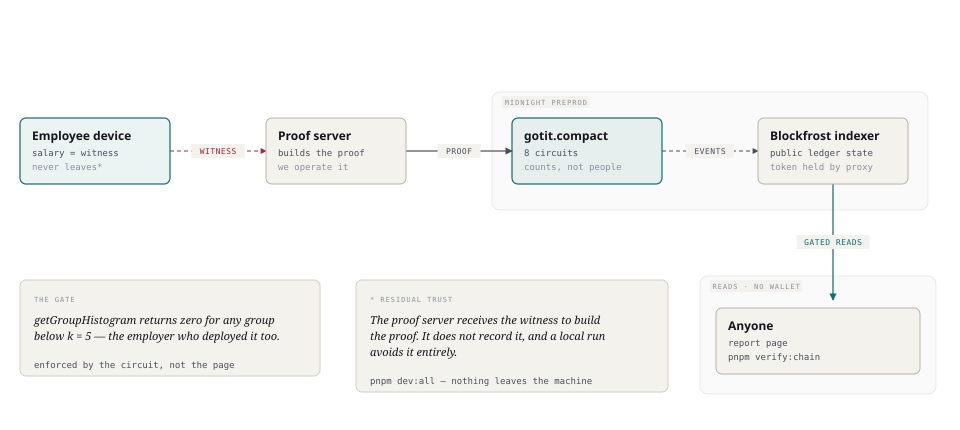
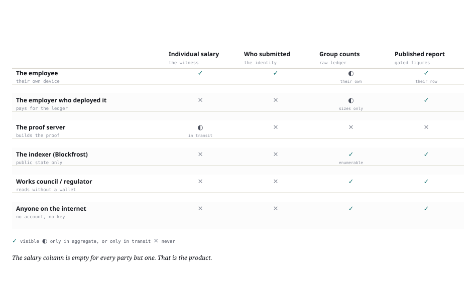

# GotIt

**Publish a pay gap report. Never expose one employee.**

A privacy-first compliance product for the EU Pay Transparency Directive. Employers produce
verifiable Art. 9 gender pay gap statistics from a ledger that holds counts and nothing else —
no salary, no name, and no way to resolve a small group back to the people in it.

[**Live app**](https://gotit-web.fly.dev) · [Report](https://gotit-web.fly.dev/#report) · [Verify](https://gotit-web.fly.dev/#verify)



---

## Product

### What it is

GotIt produces the pay gap report that Directive (EU) 2023/970 requires, from data that never
leaves the device it was entered on. An employee commits their job category, gender and
base/variable pay from their own browser. Only a count rises on the ledger. The employer gets a
report they can file and anyone can check; nobody, including the employer, learns what any
individual is paid.

### Who it is for

**The buyer: the Head of Total Rewards at a 150–2,500 person EU company.** They file the first
report by 7 June 2027 and they are the person held responsible for getting it right.

**The people who use it:**

| Role | What they do | What they need |
|---|---|---|
| Head of Total Rewards | Commissions and files the report | A defensible number, not a spreadsheet |
| Employee | Contributes their figure once per period | Assurance the figure is not attributable |
| Works council | Confirms the filing is real | To check without a court order |
| Regulator / journalist | Verifies a published report | Public reproducibility, no account |

### The problem

Art. 9 obliges employers to publish mean and median gender pay gaps, split by category of worker
and by base versus variable pay, plus the quartile distribution and the share receiving variable
pay. Art. 9(4) adds teeth: a gap of 5% or more that cannot be objectively justified triggers a
joint pay assessment with worker representatives, and the burden of proof sits with the employer.

GDPR and data-minimisation law pull the other way. Aggregate statistics re-identify people at
small group sizes — a "median pay in this team" for a team of three is a disclosure. So the
employer must publish group statistics while guaranteeing that no group statistic identifies
anyone.

Today that is resolved with a spreadsheet and an argument: export the payroll, delete the small
groups by hand, hope the deletion is defensible, and hope nobody asks how the numbers were
produced. The output is a PDF of assertions. Nothing about it is checkable, and the person who
produced it cannot prove they did it correctly.

### Value proposition

| | Spreadsheet + manual suppression | GotIt |
|---|---|---|
| Where salaries live | In a file, on someone's laptop | On the employee's device |
| Suppression | Deleted by hand, logged nowhere | Enforced by the contract; unreadable, not deleted |
| Verifiability | "Trust the PDF" | Reproduce it from public chain state in one command |
| Precision claims | Point estimates from bucketed data | Intervals, where the data only bounds the truth |
| Audit trail | Emails | An append-only ledger anyone can read |

The filing is the same obligation. What changes is whether anyone can check it — and whether the
people whose pay it describes are exposed to produce it.

### Why now

- **The deadline is fixed and close.** First reports due 7 June 2027 for employers with 150+
  workers; 250+ file annually from that date, 150–249 every three years. Budgets for this are
  being set now, and the reporting period under review is the one in progress.
- **The legal requirement is already a suppression requirement.** The Directive forces employers
  to do what privacy law already demanded, which turns anonymity from a nice property into a
  compliance feature with a citation behind it.
- **Zero-knowledge proving became practical for this shape of problem.** A histogram over a small
  domain is cheap to prove and the circuit is small. This would not have been shippable two years
  ago without a trusted aggregator.

### The key product insight

**A pay gap report is a statistic, and the privacy problem is the statistic's resolution limit,
not its inputs.**

The obvious design is to collect salaries and then anonymise them. That design has a permanent
hole: whoever aggregates sees everything, and every published figure is a promise about what was
done to the data rather than a property of the data itself.

Inverting it — the salary never leaves the device, only counts rise — makes the anonymity a
property of the ledger. But it also means some required figures cannot be computed exactly, and
the honest response is to say so rather than print a number.

That is the position this project takes. Art. 9(1)(e), the share of each group receiving variable
pay, **cannot be derived as a point estimate** here, because the ledger holds base-pay and
variable-pay submissions in separate unlinkable cells. We can prove that, we publish the interval
the model does bound, and we name the two ways to tighten it — linking a person's base and
variable pay, or counting distinct contributors per group with a second nullifier — and why we
refuse both. See [Art. 9(1)(e)](#artifact-9-1-e-the-statistic-we-refuse-to-invent).

---

## User experience

### Primary workflow

1. **The employer defines categories.** They enter their own "categories of worker" — job
   families, not job titles. Each label is hashed before it reaches the ledger, so the chain
   proves a group's size without holding its name. The label↔hash mapping is published in the
   report, because Art. 9 requires the published breakdown to be readable.
2. **Employees contribute.** In the Operator console today; from a personal link in a deployed
   company. The form takes category, gender, and base and/or variable pay. The exact figure is
   bucketed **on the device** before anything is submitted.
3. **The employer opens the report.** Art. 9 tables, intervals rather than point estimates,
   withheld groups named with the reason they were withheld, and a coverage statement.
4. **Anyone verifies.** No wallet, no account: either the hosted page, or
   `pnpm verify:chain`, which reads the ledger and reproduces the figures.

### The activation moment

**Seeing a gap with its interval, next to a withheld category — and realising which one you can
act on.**

The report is designed so those two facts arrive together. A publishable gap is a finding. A
withheld category is a coverage problem the employer can fix by recruiting participation. A
reader who confuses the two makes the wrong decision, so the report refuses to let them: they are
different sections, with different reasons, and the coverage note says plainly that participation
is voluntary and an empty category is **not** evidence that pay is equal within it.

### Important interactions

**The report page shows what it read.** The contract address and the category labels it searched
for, above the fold. A report with no rows has two very different causes — an empty ledger, or
submissions filed under labels the report is not looking for — and they look identical unless you
say which. The page says which, and counts what is on the contract independently of any label.

**Withheld rows carry their reason.** `no-data` (nobody reported), `no-comparison-group` (one side
only — not fixable by recruiting), and `below-k-anonymity-threshold` (both sides present, one too
small — fixable). Three different facts, three different responses.

**Verification is a first-class page, not a footer link.** Paste a fingerprint, get match or
mismatch against live chain state, with a plain statement of what that does and does not prove.

**The wallet flow narrates itself.** A wallet that accepts a connection and never answers is
indistinguishable from a broken app, so the connection reports its phase and escalates its
guidance: waiting, then "click the Lace icon in your toolbar", then "update Lace".

### Differentiation

Against a payroll-attestation design, which is the closest credible alternative:



A payroll-attestation design commits hashed payroll rows and has a works council approve them.
That is strictly better at one thing — it can prevent invented employees, altered salaries and
silent exclusions, because the payroll provider holds the rows before they are committed. It
cannot fill the salary column with anything but "the provider".

**Attestation verifies the employer. GotIt protects the employee.** Both are defensible; they are
not the same product. A works council that does not trust management, or an employer who would
rather not hold the data at all, wants this one.

---

## Innovation

### What is genuinely novel

**1. Disclosure control is enforced by the read circuit, not by the application.**

`getGroupHistogram` returns zero for any group below the threshold. The gate is evaluated inside
the circuit, so an employer cannot override it, publish a small cell, or write a bespoke reader
that skips it — the data is unreadable below the line, not merely withheld.

Most systems in this space implement suppression in a report generator. That is a convention: it
holds until someone writes a different reader. Here, the employer who paid for the deployment
gets zeros too.

**2. Art. 9(1)(e) is published as a proof of non-derivability rather than a fabricated number.**

The proportion of each group receiving variable pay requires knowing |base ∩ variable|. The
ledger holds |base| and |variable| in separate unlinkable cells — the property everything else
depends on — so the intersection is unknown. Rather than invent a figure, the report states the
interval the model bounds and the exact reason it cannot be tightened. Every other pay
transparency tool we have seen prints a number here.

**3. Means and gaps are intervals, and materiality is judged on the bound nearest zero.**

Bucketed data bounds the truth; it does not reveal it. A range of [−33%, +50%] has a midpoint of
+8.3%, but its sign is not provable. Flagging that as a 5% materiality breach would trigger a
joint pay assessment on a category that may be perfectly compliant. So the test uses the bound
nearest zero, and only a **proven** disparity counts.

### What technology enables it

**Midnight's Compact language and its selective-disclosure model.** The salary is a *witness* —
private input to a circuit whose only public output is an incremented counter. That is the
primitive the whole design rests on: not encryption of data at rest, but a computation whose
public output is provably independent of the private input beyond a chosen fact.

Two consequences that shaped the implementation:

- **Membership and nullifiers are derived, not stored.** The issuer receives
  `persistentHash(["gotit:member:v2", secret])` and never the secret, so it can confirm a person
  is an employee without being able to derive the nullifier that links their submission to them.
  One submission per person per period is enforced without an identity.
- **The gate is a circuit, not a policy.** Because `groupCount` is ledger state, the threshold
  comparison is something the contract can perform. Disclosure control became a read-path
  property rather than a promise.

### Why it is not a thin wrapper

- **The report engine is a from-scratch implementation of Art. 9 statistics over intervals**,
  including the materiality rule, two-sided suppression, and coverage disclosure. It is pure — no
  I/O — so a third party can re-run it and get byte-identical output, which is what makes the
  report reproducible rather than merely generated.
- **Two Compact contracts were written**, not one: `candor.compact` for the Wave 1 cut model, and
  `gotit.compact` adding the Directive's dimensions and the in-circuit gate. Eight circuits in v2,
  five in v1, and 45 tests that run against the **generated** contract rather than a mock —
  including eleven that drive the whole chain-to-report path through it.
- **Hash parity between the browser and the circuits is asserted on every build.** A drift
  between the TypeScript derivations and the circuit's `persistentHash` would silently file a
  salary in the wrong cell. The contract tests compute the same derivations the circuit does and
  compare, so a drift fails CI.
- **Read circuits execute locally against fetched state.** The gate is enforced by running the
  deployed circuit's own code, with no proof server and no wallet — so a reader who has never
  connected a wallet still gets a gated answer.

---

## Hackathon relevance

**Event:** [Midnight Buildathon](https://app.akindo.io/wave-hacks/jaMZjqPOBsLXvjdG), Wave 2
(build period 29 Sep – 19 Oct 2026).

**Selected categories:** Compliance · Enterprise · Privacy.

**Sponsor technology and meaningful integration.** The project is not a Midnight-themed CRUD app:

| Midnight capability | How it is used |
|---|---|
| Compact circuits | 8 circuits in the v2 ledger, plus 5 in the deployed v1 ledger |
| Private witnesses | The salary is a witness; it is never a public input to any circuit |
| Selective disclosure | Only bucket indices and a group key are disclosed |
| Nullifiers | `persistentHash(["gotit:nf:v2", epoch, secret])` — one submission per person per period, no identity |
| Ledger state as a gate | `groupCount` vs `kThreshold` evaluated in the read circuit |
| Preprod deployment | Both ledgers live on Preprod with real transactions |
| Indexer reads | Gated reads through the indexer, plus independent reproduction via CLI |

Judging criteria this targets: **Backend Engineering** (circuit design, disclosure control,
hash-parity testing), **QA** (278 tests, 45 against the generated contracts, an integration suite
that drives the app's real pipeline), **Product** (a named buyer, a fixed deadline, a filing the
employer actually has to produce), and **Communication** (a public post-mortem of the previous
wave, an honest limitations section, and a README that does not overclaim).

The [Wave 1 post-mortem](docs/WAVE1-POSTMORTEM.md) is public. It explains why the previous
submission scored zero despite a working build.

---

## Architecture


### System overview

Four packages, one deployed web app, two deployed contracts.

| Component | Path | Responsibility |
|---|---|---|
| Report engine | `packages/shared/src/paygap.ts` | Art. 9 statistics. **Pure — no I/O — so any third party can re-run it and get identical output.** |
| Hashing | `packages/shared/src/hash.ts` | The single source of truth for every value the circuits also derive. Two frozen versions (v1 `candor:*`, v2 `gotit:*`). |
| v2 ledger | `packages/contract/src/gotit.compact` | 8 circuits. The Directive's dimensions plus the in-circuit gate. |
| v1 ledger | `packages/contract/src/candor.compact` | 5 circuits. Deployed in Wave 1, **frozen** — its hash domains are inputs to live state. |
| Circuit tests | `packages/contract/src/*.test.ts` | 45 tests against the generated contracts, off-chain. 13 for v1, 21 for v2, 11 driving chain → shape → report. |
| Reproduction CLI | `packages/contract/src/chainRead.ts` | Reads the ledger and prints the report. No wallet, no key. |
| Diagnostics CLI | `packages/contract/src/diagnoseContract.ts` | What a deployed contract holds, without the app in the path. |
| Web app | `apps/web` | Report, verification, contribution, Operator console. |
| Issuer | `packages/issuer` | Work-email verification. **Demo mode — see [Verification](#verification).** |

### Data flow

**A contribution.** The employee's browser buckets the figure locally, builds a witness, and sends
the private inputs to the proof server, which returns a proof. The signed transaction reaches
Preprod through the wallet. The contract checks membership, spends a per-period nullifier,
increments `histogram[hash(category, gender, component, bucket)]` and
`groupCount[hash(category, gender, component)]`. Nothing else is written.

**A report.** The app fetches the contract state from the indexer. It reads the group headcounts
from raw state — needed for coverage and for the suppression reason — and it reads the **figures**
through the contract's own `getGroupHistogram`, which returns zeros below the threshold. The two
are cross-checked: if raw state calls a group publishable and the gated read disagrees, the report
**throws rather than publish**. The engine then assembles the Art. 9 tables, applies two-sided
suppression, and produces markdown, JSON and a fingerprint.

### Important technical decisions

**The gate lives in the read circuit, and the read circuit is executed locally.** Fetching state
once and running `getGroupHistogram` in-process means the gate is enforced without a proof, a
transaction or a fee. This matters more than latency: the first version of this reader called an
API that did not exist, and because it only ran when a v2 contract existed, nothing caught it.
The replacement had to be cheap enough that nobody would be tempted to route around it. See
[`lib/localGatedReader.ts`](apps/web/src/lib/localGatedReader.ts).

**Headcounts come from raw state; figures come from the gate.** A published figure must never be
sourced from raw ledger state, because that bypasses the gate. But a headcount *must* come from
raw state, because the gated read returns zero for a suppressed group — and a report that cannot
tell "three people, withheld" from "nobody here" cannot report coverage honestly. The split is
deliberate, documented at both ends, and guarded by an assertion.

**Category labels are hashed, and the mapping is published.** The ledger stores
`persistentHash("gotit:catkey:v2" || label)`. The chain proves a group's size without holding its
name. The label→hash mapping travels in the report. The sharp consequence, which cost a debugging
session: **a submission filed under a label the report is not searching for is invisible**, and
the ledger cannot say so, because it never stored the name. So the app shares one category list
between the contribution form and the report, and offers a **label finder** that tests a
guessed label against the on-chain hashes.

**Two contracts, not a migration.** The Wave 1 ledger keyed its histogram on a
`(family:level:region)` cut, which cannot express a category of worker, a gender split, or base
versus variable. Changing the hash domain strings would invalidate every existing leaf and
nullifier on a live deployment, so v2 is a separate contract with its own `gotit:*` domains. A v1
leaf deliberately does not validate against v2.

### External services

| Service | Purpose | Failure behaviour |
|---|---|---|
| **Blockfrost** (indexer + RPC) | Public state, transaction submission | The app classifies the failure — decommissioned, missing token, invalid token, wrong path, unreachable — and shows the cause with the fix, rather than rendering sample data as chain data |
| **Proof server** (self-hosted) | Generates proofs | A locked or unavailable prover reports its phase; local proof server on `:6300` for the offline path |
| **Fly.io** | Hosting for the web app and the proof server | — |
| **Lace** | Browser wallet: signing and submission | Connection is narrated; a wallet that never answers is distinguished from a locked one |
| **Preprod faucet** | Free tNIGHT → tDUST for test deployment | Documented in `docs/DEPLOY.md` §3, including the two errors that actually happen |

### Frontend / backend boundaries

There is no backend that sees a salary. The boundaries are:

- **The device** holds the witness, buckets the figure, and derives the membership leaf and
  nullifier. Nothing salary-related crosses it.
- **The proof server** receives the private inputs to build a proof. It does not record them — and
  this is the residual trust assumption, stated in the Limitations section rather than buried.
- **The contract** holds counts, group sizes, nullifiers and membership leaves. All public.
- **The web app** is a static bundle. Caddy proxies `/indexer`, `/proof-server` and `/issuer`
  same-origin, which lets the indexer token be injected server-side so it never reaches the
  browser.

---

## Running

### Prerequisites

- Node.js 22+
- pnpm 9+
- Docker (for a local proof server, or a full local network)

### Installation

```bash
git clone git@github.com:PhiBao/gotit.git
cd gotit
pnpm install
```

### Environment variables

Nothing is required to read. A `.env` at the repo root is only needed for deployment work.

| Variable | Where | Purpose |
|---|---|---|
| `BLOCKFROST_PROJECT_ID` | Fly secret on the web app | Preprod indexer token. Injected into the proxy, never into the bundle. |
| `MIDNIGHT_INDEXER` / `MIDNIGHT_INDEXER_WS` | shell | Override the indexer for the CLIs |
| `PROOF_SERVER` | shell | Local proof server, default `http://localhost:6300` |
| `CONTRACT_ADDRESS` | shell | Contract for the CLIs, or pass `--address` |
| `GOTIT_ISSUER_KEY` | Fly build arg | 32-byte hex issuer key. Committed for the demo; see Known risks |

### Development commands

```bash
pnpm dev                 # web app on :5173, sample data, no chain
pnpm dev:all             # issuer + web + local proof server — nothing leaves the machine
pnpm build               # build everything, then verify the zk artefacts are consistent
pnpm check:artifacts     # assert the bundled and served contract artefacts match
pnpm check:submission    # lint the submission draft
pnpm typecheck           # tsc across the workspace
```

### Test commands

```bash
pnpm -r test                                        # 278 tests
pnpm --filter @gotit/contract test                   # 45, against the generated contract
pnpm --filter @gotit/web test                        # 193, incl. the app's real pipeline
pnpm --filter @gotit/web exec vitest run labelFinder # a single file
```

**Recompiling the contract:**

```bash
pnpm --filter @gotit/contract compile
pnpm --filter @gotit/contract build      # refreshes dist/managed — the web build imports this
pnpm --filter @gotit/web sync:zk         # copies artefacts to the served path
```

> Both steps are needed. Skipping `build` leaves the bundle importing a stale contract while the
> server offers a newer one, which fails at runtime with an empty error message. `pnpm build` runs
> the check that catches it.

### Production build

```bash
pnpm build
fly deploy -c fly.web.toml               # https://gotit-web.fly.dev
```

`pnpm build` runs the zk artefact check first and fails if the contract the bundle imports and the
artefacts it will be served disagree — the failure mode that otherwise surfaces at runtime with an
empty error message.

### Reproducing a report from public chain state

```bash
pnpm --filter @gotit/contract verify:chain -- \
  --address 92fb35dbabd74dc97222c0ce5f7b72f2aed83c6c7d264a5ef94431199720c0d0 \
  --categories engineering,sales,operations,management
```

No wallet, no account, no key. This is what a works council or a regulator runs.

---

## Demo

### Deployed application

**One deployment: https://gotit-web.fly.dev** — Preprod, where both contracts live.

| | URL | Notes |
|---|---|---|
| Report | `/#report` | Reads the v2 ledger. No wallet, no account. |
| Verify | `/#verify` | Paste a fingerprint, get match or mismatch. |
| Report with illustrative data | `/#report&sample` | Clearly labelled sample, **never** an automatic fallback. |
| Contribution + Operator | the header controls | Operator holds deploy, enrol and the v2 contribution form. |

### What a judge should try first

1. **Open the report.** No wallet, no account, no permission. It shows the contract it read, the
   category labels it searched for, the threshold in force (`k=5`), the participant counts, and
   which groups it withheld and why.
2. **Open `#report&sample`.** The same page with a clearly-labelled illustrative dataset, showing
   publishable rows with intervals, a material gap flagged at the Art. 9(4) threshold, a
   one-sided category withheld, and a small category below k.
3. **Open the verification page and paste a fingerprint.** Then change one character and watch it
   fail — a check that cannot fail proves nothing.
4. **Run the reproduction CLI** (above). This is the difference between a report and a claim.
5. **Read the withheld table and the coverage note.** The distinction between "withheld" and
   "nobody here" is the product.

### Required setup for contributing

Contributing needs a wallet, because a contribution is a transaction. Reading needs nothing.

1. Install **Lace** and update it to the newest version — an older build can accept a connection
   request and never answer it.
2. Switch Lace to **Preprod**.
3. Request tNIGHT from the [Preprod faucet](https://midnight-tmnight-preprod.nethermind.dev/) to
   your **unshielded** address (`mn_addr_preprod1…`), wait for it to confirm, then press
   **Generate tDUST** in Lace.
4. Open the app → **Operator** → **Deploy v2**, then use the contribution form.

### Demo flow (3 minutes)

`docs/DEMO.md` is a full shot list. The short version:

1. `#report&sample` — intervals, a material gap, a withheld category, the coverage note.
2. `#verify` — paste, match, then tamper and watch it mismatch.
3. `gotit.compact` in an editor — the gate, in one circuit.
4. Contribute, then submit twice and watch the nullifier reject the second.
5. Close on the three properties: **provable, unlinkable, suppressible.**

---

## Verification

What is real, what is deployed, and what is not. **Nothing mocked is presented as working
functionality.**

### Implemented and real

| Thing | Status |
|---|---|
| `gotit.compact` (8 circuits) | **Real.** Compiled with Compact 0.31.1 / language 0.23. 45 tests against the generated contract. |
| `candor.compact` (5 circuits) | **Real and deployed.** Wave 1's ledger, frozen. |
| Art. 9 report engine | **Real.** Pure functions, 40 tests, no I/O. Reproducible by construction. |
| Interval arithmetic and the materiality rule | **Real.** Uses the bound nearest zero, not the midpoint. |
| In-circuit disclosure gate | **Real.** `getGroupHistogram` returns 0 below `kThreshold`. |
| Local gated reader | **Real.** Executes the deployed circuit's code against fetched state. |
| Two-sided suppression | **Real.** A row is withheld unless both sides clear k. |
| Hash-parity tests | **Real.** TypeScript derivations compared with circuit derivations. |
| Indexer failure classification | **Real.** Distinguishes decommissioned / missing token / invalid token / incompatible / unreachable. |

### Live and on-chain

| Thing | Where |
|---|---|
| v2 contract | Preprod, `92fb35dbabd74dc97222c0ce5f7b72f2aed83c6c7d264a5ef94431199720c0d0` — 5 members, 5 submissions |
| v1 contract | Preprod, `e7cf6ffc48ebeb450813104e6a5ab3d585f7e275bcd32e5ea82eb7a8c21dd53d` — real transactions |
| Web app | https://gotit-web.fly.dev |
| Proof server | https://candor-midnight-prover.fly.dev (proof-server 8.1.0) |
| Blockfrost indexer | Through the app's same-origin proxy; token injected server-side |

### Externally verifiable

- **Reproduce the report**: `pnpm verify:chain` against the address above.
- **Inspect the contract state**: any Preprod indexer query for the same address.
- **Read the circuit**: `packages/contract/src/gotit.compact` — the gate is nine lines.
- **Re-run the tests**: `pnpm -r test`, no credentials required.
- **Diagnose a contract**: `pnpm --filter @gotit/contract diagnose:contract --address <addr>`.

### Mocked or simulated — stated plainly

| Thing | What is actually happening |
|---|---|
| **Work-email verification** | `packages/issuer` logs the code and **returns it in the HTTP response** (`demoCode`). There is no SMTP integration. The membership *mechanism* is real — a leaf is enrolled on-chain through the issuer key — but the email step is a demo stand-in. |
| **`#report&sample`** | Figures are **generated in the browser**. Not from the ledger. Labelled `ILLUSTRATIVE SAMPLE — not chain data`, with a banner, a `SAMPLE DATA` period label, and a note saying the figures must never be filed. It is **never** an automatic fallback: a failed live read errors. |
| **Local sample ledger** (`lib/ledger.ts`) | The landing page's cut grid uses a local dataset when no chain read has succeeded, labelled `Sample dataset — not chain data`. |
| **Hosted proving** | Real proofs, generated by a proof server that **receives the private inputs**. See Known risks. |
| **Category labels** | Not mocked, but *off-chain by design*: the ledger stores hashes and the labels travel in the report. |

### Deliberately not built

HRIS integration, zkEmail, multi-entity federation, direct filing with a national authority,
mobile, and a production issuer. The payroll connector is the Wave 3 plan, and it is also the
direct answer to the sharpest critique of this space: that the product has to become a plugin for
the systems companies already run rather than a standalone app.

---

## Security and reliability

### Threat considerations

| Threat | Mitigation |
|---|---|
| **Re-identification from published statistics** | Two independent layers: the circuit returns 0 below `k=5`, and the report engine withholds a row unless *both* sides clear k. `assertNoSmallCellLeak` re-derives the suppression and **throws** rather than publish a below-threshold row. |
| **A full team lifting a team of one** | `groupCount` is keyed per `(category, gender, component)`, never globally. |
| **Employer overriding suppression** | The gate is in the read circuit. The employer who deployed the contract gets zeros too. |
| **The aggregator learning salaries** | There is no aggregator. The salary is a witness and is never a public input. |
| **Double submission inflating a group** | A per-period nullifier, `persistentHash(["gotit:nf:v2", epoch, secret])`, is spent on submit. `nextEpoch` re-opens the period and every prior nullifier stays spent. |
| **Non-members contributing** | Membership is an issuer-gated leaf; `submit` asserts membership. |
| **Anyone-but-the-issuer enrolling** | `enroll` and `nextEpoch` assert the caller's key against the public issuer commitment. |
| **A reader bypassing the gate** | Published figures come from the circuit. `crossCheckGated` re-reads every group raw state calls publishable and throws if the two disagree. |
| **Indexer token leaking to the browser** | The token is a Fly secret; Caddy injects the header server-side. `indexerPublicDataProvider` takes no headers, so the client cannot send one even if it wanted to. |
| **A stale contract address** | Addresses are validated on read *and* write. A malformed value is ignored with a warning rather than becoming a contract that does not exist — a bug that shipped once and produced "deployed at undefined". |

### Permission model

Three credentials, each with a narrow scope:

- **The issuer key** authorises `enroll` and `nextEpoch`, and nothing else. It cannot read
  anything, and it cannot submit on anyone's behalf.
- **The submission secret** is generated on the device and never transmitted. It derives the
  membership leaf (shared with the issuer) and the period nullifier (shared with nobody).
- **The wallet** signs and pays. It has no special ledger permission beyond being a wallet.

There are no accounts, no sessions and no server-side identity. The report page and the
verification page require no permission at all.

### Sensitive flows

**A salary entering the system** is the flow that matters. It is bucketed in the browser before
submission; the exact figure is never sent. The **one exception** is the proof server, which
receives the private inputs in order to generate the proof. That is the residual trust assumption
and it is stated in Limitations rather than omitted.

**The read path is the other sensitive flow**, because a bug there is silent. Three defences: the
gate is in the circuit, the app never sources a published figure from raw state, and an assertion
re-checks the finished report.

### Failure handling

The governing principle: **a plausible-looking number is worse than an error message**, because
the output of this system is meant to be filed.

- A failed live read shows an error and names the cause. It never substitutes sample data.
- An empty report distinguishes "empty ledger" from "submitted under labels we are not searching
  for" from "configured groups have data but no category has both genders above k".
- A contract whose ledger lacks the Art. 9 dimensions is identified as such rather than producing
  a decoder crash.
- Wallet failures are classified: locked, declined, no wallet installed, or not answering — with
  the action each requires.
- The zk artefact check runs on every build, because a bundle that disagrees with the artefacts it
  is served fails inside midnight-js with an **empty** error message.

### Known risks

**1. The proof server receives the witness.** Proving happens on a server, and to build a proof
that server must have the private inputs. In the hosted deployment it is a server we operate; it
does not persist them, and `pnpm dev:all` keeps everything on one machine. Removing the server
from the trust path entirely needs client-side proving or a GPU proving service — this is the
largest honest gap in the design.

**2. The issuer learns who is an employee.** It receives a membership leaf and an email address.
It cannot link a leaf to a submission, because it never receives the secret that derives the
nullifier — but it does know who works where. Replacing it with a Merkle membership proof is the
Wave 3 plan.

**3. `groupCount` is public ledger state.** A determined analyst can query an indexer directly and
learn that a group has, say, four members. The gate protects the *pay bands*, not the existence of
a group — and the existence of a group is not the sensitive fact. Published figures are protected
by the report's suppression, which is what a filing is checked against.

**4. `k=5` is a default, not a legal determination.** It is fixed at deployment and readable via
`readK()`, so a report states the threshold in force. Choosing it per-jurisdiction and
per-category is product work that has not been done.

**5. The issuer key is committed** for the demo (`fly.web.toml` → `VITE_ISSUER_KEY`). It is a
testnet key with no value at stake, and it makes the demo runnable without setup. A production
deployment must not do this, and the interface is built for the key to live in an operator's
browser instead.

**6. Participation is voluntary, and the report says so.** An incomplete response rate is
detectable but not prevented. A report that is true about 60% of a company is still true about
60% of it, and the coverage note says exactly that rather than implying full coverage.

---

## Limitations and roadmap

### Current limitations

- **The payroll connector does not exist.** Employees enter their own figures, which is the
  privacy-maximising choice and also the adoption-minimising one. Nobody wants to be the first
  person in their company to submit.
- **No attestation.** Because no party holds the salary, the system cannot prove that a submitted
  figure is the figure actually paid, that an employee was not omitted, or that a category was
  not defined to bury a gap. This is the real cost of the model, and it is the mirror image of the
  payroll-attestation approach's cost.
- **Art. 9(1)(e) cannot be computed as a point estimate.** Proven, stated, and explained — but it
  is one of the required figures and a filing will want a number. See the section below.
- **`preview`-checks only.** The contracts are on a test network. Mainnet deployment goes through
  Midnight Foundation review.
- **The report is published as markdown, JSON and a fingerprint**, not as a filing pack in a
  national authority's format. No authority format exists yet.
- **One employer per contract.** No multi-entity or group consolidation.

<a id="artifact-9-1-e-the-statistic-we-refuse-to-invent"></a>
### Art. 9(1)(e): the statistic we refuse to invent

The Directive asks for the proportion of each group receiving complementary or variable pay.
Computing it needs |base ∩ variable| — the people who received both.

The ledger holds base-pay and variable-pay submissions in **separate, unlinkable cells**. That is
not an oversight; it is the property that makes the rest of the design possible. So |base| and
|variable| are exact and their intersection is unknown. Any single number printed here would be a
guess wearing the costume of a statistic.

The report publishes the interval the model bounds and states the reason. The two ways to tighten
it are both privacy regressions, and both are named in the output:

1. **Link a person's base and variable pay** — reveals both figures for one individual. Refused.
2. **Count distinct contributors per group with a second nullifier** — reveals that one person
   submitted both. Refused.

This is the same honesty move as reporting means as intervals, applied to the statistic most
published reports fabricate. A reviewer can check the reasoning rather than take a number on
trust.

### Known tradeoffs

| Decision | Cost |
|---|---|
| No attestation | Cannot prove a figure is real, or that nobody was omitted |
| Voluntary participation | Coverage is whatever people choose to give |
| Intervals instead of point estimates | Every mean and gap is a range |
| Two contracts rather than a migration | Two ledgers to explain, and v1 state is not visible to v2 reports |
| Local circuit execution for reads | Re-executes the circuit per group per report; cheap, but it is work the client does |
| The gate at the group level, not per bucket | A group's total is visible to anyone who queries raw state |

### Next steps

1. **Deploy the payroll connector.** The read-only CSV path is the smallest useful version, and it
   is what the sharpest critique of this space asks for: become a plugin for the systems companies
   already run.
2. **A pilot with a named employer**, producing a real report on real data with a real works
   council reading it.
3. **Client-side proving**, or a proving service with a stated retention policy, to remove the
   proof server from the trust path.

### Future direction

The interesting version of this product is not a report generator. It is the piece of
infrastructure that makes a pay claim checkable.

If the counts are on a ledger and the statistics are reproducible, then the same substrate answers
questions nobody can currently answer: whether a gap closed after an intervention, whether a
category's distribution moved between periods, whether an employer's published figure is
consistent with its previous one. Today those questions are unanswerable because the data is a PDF
and the PDF is an assertion.

The near-term commercial entry is the compliance deadline and a buyer with a date. The durable
position is the verification layer for pay claims — the thing that makes "our gap is 9%" a
statement someone can check rather than a sentence in a document.

---

## Repository layout

```
packages/shared/          report engine, hashing, shared types (pure)
packages/contract/        two Compact ledgers, 45 circuit tests, CLI tools
packages/issuer/          work-email verification (demo mode)
apps/web/                 Vite + React app
docs/                     spec, deployment, demo guide, post-mortem, diagrams
scripts/                  artefact check, submission lint
```

| Document | What it covers |
|---|---|
| [docs/SPEC.md](docs/SPEC.md) | Product specification, reporting model, the gate, the read split |
| [docs/DEPLOY.md](docs/DEPLOY.md) | Deployment, wallet funding, the indexer migration, troubleshooting |
| [docs/DEMO.md](docs/DEMO.md) | Demo guide and video shot list |
| [docs/SECURITY.md](docs/SECURITY.md) | Security notes |
| [docs/WAVE1-POSTMORTEM.md](docs/WAVE1-POSTMORTEM.md) | Why the previous submission scored zero |
| [docs/diagrams/](docs/diagrams/) | Diagram sources — regenerable with `python3 docs/diagrams/build_*.py` |

## Licence

Apache-2.0.
